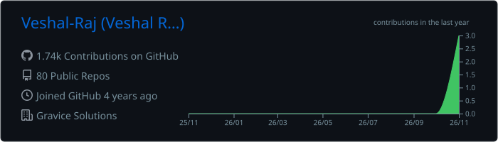
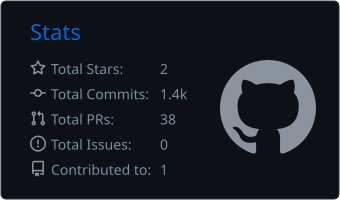
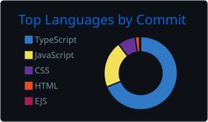

<h1 align="center">Hi, I'm Veshal Raj 👋</h1>
<h3 align="center">Software Engineer · Backend & AI · Cloud · Project & Client Delivery</h3>

  
  
  

---

## 🚀 About Me

I build **production-grade backend, AI, and enterprise applications**, taking projects from requirements and architecture through development, deployment, and production.

- 🏢 **SDE at [Gravice Solutions](https://www.linkedin.com/in/veshal-raj/)** (Sep 2025 – Present), where I lead client projects, make technical decisions, review implementations, and mentor junior engineers
- 🤖 Currently building **AI Agents, RAG-based applications, and LLM solutions** with **LangChain**
- ☁️ Managing cloud infrastructure and production environments, including deployments and operational improvements
- ☕ Expanding into the **Java ecosystem and Spring Boot** through production work
- 💡 I enjoy solving problems beyond code: understanding the business need, designing the right solution, and helping the team deliver it reliably

## 🧭 Areas I Work In

| | |
|---|---|
| 🏗️ Backend Engineering & System Design | 🤖 AI Agents, RAG & LLM Applications |
| 🔗 LangChain & AI Engineering | 🟢 Node.js, TypeScript, Express & NestJS |
| ⚛️ React & Micro Frontend Architecture | ☕ Java & Spring Boot |
| ☁️ Cloud Infrastructure & DevOps | 📨 Distributed & Event-Driven Systems |
| 💳 FinTech & Enterprise Applications | 🤝 Client & Stakeholder Collaboration |
| 🧑‍🏫 Technical Leadership & Mentoring | |

## 💼 Experience

**SDE** · Gravice Solutions · *Sep 2025 – Present* · Bengaluru
> Delivering client projects end to end, leading technical decisions, building AI/LLM applications, and managing cloud and production environments.

**Product Engineer** · Samaaro · *Jun 2024 – Aug 2025* · Remote
> Built core features for the main product and developed customized client solutions on top of it.

**Freelance Web Developer** · Self-Employed · *Nov 2023 – May 2024* · Remote
> Improved application performance by fixing pagination bugs and implementing debounced search, cutting API calls by 50%.

## 🛠️ Tech Stack

**Languages**

**Backend**

**AI / LLM**

**Frontend**

**Databases**

**Cloud & DevOps**

**Tools**

## 📊 GitHub Stats

  

  
  

  

---

  💬 Open to conversations about backend systems, AI applications, and interesting engineering problems. 
  Reach me on <a href="https://linkedin.com/in/veshal-raj">LinkedIn</a>.

